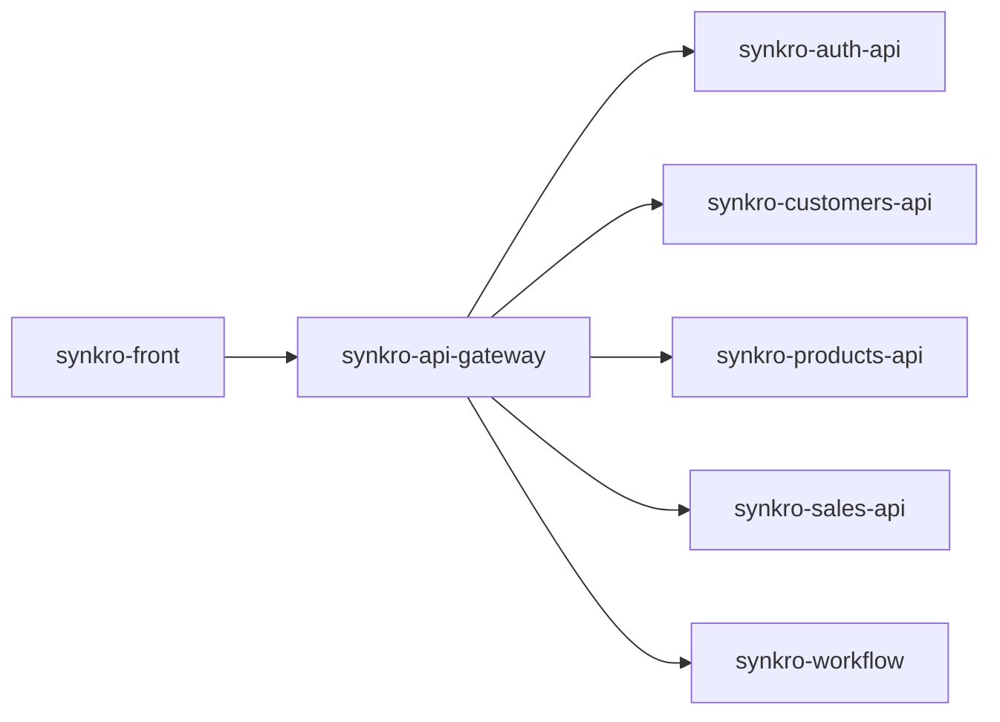

# synkro-api-gateway

> NGINX entry point that routes public HTTP requests, requires credentials on protected paths and applies rate/CORS/correlation policy.

Part of the **SynkroTech SAS Sales Management System**. Architecture, decisions and
contracts live in [synkro-docs](https://github.com/code-corhuila/synkro-docs).

**Quick start:** from this root, prepare `.env`, provision platform if absent, then start `deploy/compose.yml` with Docker Compose. See [Getting started](#getting-started).

## What it does

- Routes Auth, Customers, Products, Sales and Workflow prefixes to their owning services.
- Checks credential presence on protected routes; each service verifies the token cryptographically.
- Applies general and login-specific rate limits, CORS and X-Correlation-Id propagation.
- Keeps startup independent of upstream availability using per-request DNS resolution.

## Where it fits



The gateway publishes backend port 8000. Domain APIs remain internal to platform; the Host exposes the browser application separately.

## Tech stack

| Component | Choice |
|---|---|
| Proxy | NGINX 1.27 Alpine |
| Configuration | envsubst-rendered template and reusable snippets |
| Tests | Bash smoke suite and curl |
| Runtime | Docker service; public HTTP 8000 |

## Dependencies

| Depends on | Purpose | Configuration |
|---|---|---|
| platform | Internal name resolution and connectivity | External Docker network |
| Domain APIs and Workflow | Upstream operation owners | Named internal upstreams on 8080 |

## Getting started

From this root in **Bash** (Git Bash or WSL on Windows), with Docker Desktop's Linux engine:

```bash
docker network inspect platform >/dev/null 2>&1 || docker network create platform
cp .env.example .env
docker compose -f deploy/compose.yml --env-file .env up -d --build
curl http://localhost:8000/health
```

Upstreams can join later; unavailable services produce a controlled 503.

For the complete platform, start from [synkro-infra-postgres](https://github.com/code-corhuila/synkro-infra-postgres).

## Configuration

The committed [.env.example](.env.example) is the configuration inventory.
Its values are examples; required inputs and defaults follow its comments and the
owning implementation. Keep real secrets in protected local files.

| Variable | Purpose |
|---|---|
| `CORS_ALLOWED_ORIGINS` | Connection address, origin or build-time entry point |
| `RATE_LIMIT_PER_SECOND` | Rate limit per second |

## Interface

| Public path | Destination / policy |
|---|---|
| GET /health | Gateway health; public |
| POST /api/v1/auth/login; POST /refresh | Public Auth flows; login has a tighter rate budget |
| /api/v1/auth/... | Auth; remaining paths require Authorization |
| /api/v1/customers/... | Customers |
| /api/v1/products/...; /api/v1/stock-alerts/... | Products |
| /api/v1/sales/... | Sales |
| /api/v1/sagas/... | Workflow |

Unknown routes return 404. Missing credentials, rate limits and unavailable upstreams use the shared error envelope. Stock-reservation routes remain internal service calls.

## Project structure

```text
templates/     routes, upstream resolution and response policy
snippets/      common headers, CORS and protected/public routing
deploy/        NGINX Dockerfile and Compose service
tests/         smoke checks against the running gateway
docs/          standalone operation and test details
```

## Testing

From this root in **Bash**, against the explicitly prepared test layout:

```bash
./tests/smoke.sh
```

Test 3 needs Products, while tests 4/8 expect Auth to be absent. The suite is not a generic check against an arbitrary live platform. Its rate-limit reset and PRODUCTS_API_AVAILABLE option are retained in the testing guide.

## Branching and contributing

Use a `feat/`, `fix/` or `chore/` child branch and a PR into `develop`.
Permanent branches are `develop`, `qa` and `main`; none accepts direct commits.
Promote through a `qa-<description>` or release child with `git cherry-pick -x`.
`main` requires approval from `ariel5253`. Use English Conventional Commits.
See [Git conventions](https://github.com/code-corhuila/synkro-docs/blob/main/00-governance/git-conventions.md).

## Further documentation

- [Local development](docs/local-development.md).
- [Testing](docs/testing.md).
- [Domain rules](https://github.com/code-corhuila/synkro-docs/blob/main/02-domain/entities-and-rules.md), [contracts](https://github.com/code-corhuila/synkro-docs/tree/main/07-api/contracts/openapi) and [testing strategy](https://github.com/code-corhuila/synkro-docs/blob/main/11-quality/testing-strategy.md).

<!-- Preserve previously published README section links. -->
<a id="branching"></a>
<a id="running-locally"></a>
<a id="running-the-tests"></a>
